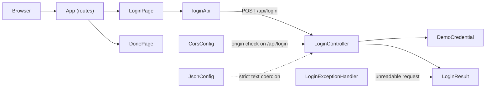
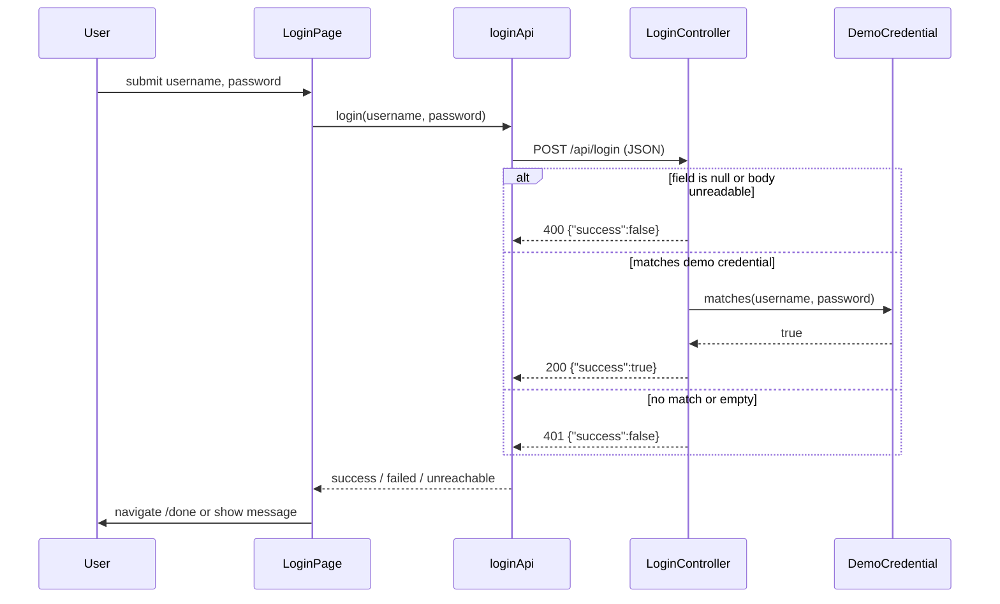

## Architecture Analysis

### System Overview
Two independently run processes in one repo: a Spring Boot REST API (`backend/`, port 8080) and a Vite/React single-page app (`frontend/`, port 5173). The SPA calls the API with `fetch`. There is no database, no persistence and no session state.

### Architectural Style
Monolithic, two-tier client/server POC. Evidence: a single Spring Boot application class (`AuthApiApplication.java`) with one controller, and one SPA with two routes.

### Component Relationships

Text fallback: Browser -> App -> LoginPage/DonePage; LoginPage -> loginApi -> POST /api/login -> LoginController -> DemoCredential; LoginController returns LoginResult; LoginExceptionHandler, CorsConfig and JsonConfig act as cross-cutting configuration around the controller.

### Data Flow
1. User types username and password in LoginPage state.
2. `loginApi.login` posts JSON `{username, password}` to `${VITE_API_BASE_URL || http://localhost:8080}/api/login`.
3. `LoginController.login` returns 400 if a field is null, 200 `{"success":true}` if `DemoCredential.matches` is true, otherwise 401 `{"success":false}`.
4. The frontend reads only the status code: 200 -> navigate to `/done`; 400/401 -> failed message and cleared password; anything else or a thrown error -> unreachable message.

### Key Design Decisions
- Identical failure body for every failure cause (`LoginResult(false)`), so responses do not reveal which field was wrong.
- Strict Jackson coercion (`JsonConfig`) rejects numbers/booleans where text is expected, giving 400.
- CORS allows only one configured origin (`app.cors.allowed-origin`) and only for `/api/login`, method POST, header Content-Type, no credentials.
- No tokens or cookies; "login done" is a client-side route with no server-checked session.
- Hardcoded demo credential as a documented POC exception (ADR-002).

### Improvement Opportunities
- Introduce a user store abstraction so login does not depend directly on the constant `DemoCredential` (needed by the active intent).
- Generalize CORS mapping, exception handler and response record names beyond "login" if more endpoints are added.
- Add coverage config and CI; stop tracking `backend/target/`.

## Interaction Diagrams

### Login (existing)

Text fallback: the user submits the form; the client posts to /api/login; the controller answers 400 for null/unreadable, 200 for the demo credential, 401 otherwise; the client navigates to /done on 200 or shows a message.
