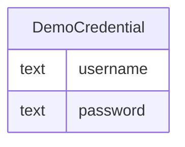

# Functional Spec: u1-auth-api

This unit implements the backend half of stories US1.1, US1.2, US2.1 and US2.2. U2 delivers the screens.

## Workflow: Check a login

1. U1 receives `POST /api/login` from the frontend.
2. If the body is missing, not valid JSON, not the expected shape, or a field is missing or null, answer 400 with `{ "success": false }` (BR1.4).
3. If the username or password is empty, answer 401 with `{ "success": false }` (BR1.3).
4. Compare the username and password with the demo credential, exactly and case-sensitively (BR1.1, BR1.3).
5. If both match, answer 200 with `{ "success": true }` (BR1.1).
6. Otherwise answer 401 with `{ "success": false }` (BR1.2).
7. Every failure body is the same and names no field (BR1.8). No response issues a session or token (BR1.5) or contains the credential (BR1.6).

## State Machine

None. U1 is stateless: each request is judged alone and nothing is remembered between requests (BR1.5).

## Entity-Relationship View

Text fallback: one entity, DemoCredential, with username and password and no relationships.

## Rules Summary

See the table in `rules.md`: BR1.1 to BR1.8.

## Stories Implemented

US1.1, US1.2, US2.1, US2.2 (backend side only; the form, redirect and failure message are in u2-login-ui).

## Open Points Carried From Contract Design

- The local ports for the frontend and backend are fixed during Code Generation, because BR1.7 names the frontend address.
- What the form shows when U1 does not answer at all belongs to u2-login-ui.

## Sources

- unit-of-work.md: `aidlc/spaces/default/intents/261115-basic-login/inception/units-generation/unit-of-work.md` (U1)
- unit-of-work-story-map.md: `aidlc/spaces/default/intents/261115-basic-login/inception/units-generation/unit-of-work-story-map.md`
- stories.md: `aidlc/spaces/default/intents/261115-basic-login/inception/user-stories/stories.md`
- contract-summary.md: `aidlc/spaces/default/intents/261115-basic-login/inception/contract-design/contract-summary.md`

## Assumptions & Open Questions

None.
