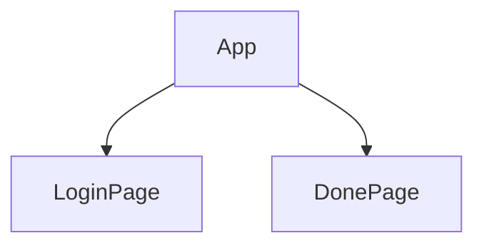

# Frontend Components: u2-login-ui

## Component Hierarchy

Text fallback: App chooses between LoginPage (`/`) and DonePage (`/done`).

| Component | Role | State | Props |
|---|---|---|---|
| App | Chooses the screen from the address | none | none |
| LoginPage | The form, the submit and the message area | username, password, status (idle, submitting, failed, unreachable) | none |
| DonePage | Shows "login done." only | none | none |

## Interaction Flow

LoginPage follows the workflow and state table in `functional-spec.md`. On a 200 answer it moves the browser to `/done`.

## Form Validation

There is no validation in the form. Empty values are sent to the backend, which answers 401 (functional-spec step 2). The only form-side guard is disabling submit while a request is in flight.

## Messages

| Case | Exact text |
|---|---|
| Failed login (401 or 400) | Invalid username or password |
| Server unreachable (no answer, network error, other status) | Unable to reach the server. Please try again. |
| Success screen | login done. |

## Test Hooks

Interactive and message elements carry `data-testid` attributes so tests and automation can find them: `username`, `password`, `submit`, `login-message`, and `login-done`.

## API Integration

One call: `POST /api/login` on the backend address (default `http://localhost:8080`) with `{ "username", "password" }` as JSON (contract C1). The form reads only the status code. 200 means success, 401 or 400 means failed, and anything else means unreachable. The response body is not needed.

## Sources

- functional-spec.md in this folder
- contract-summary.md: `aidlc/spaces/default/intents/261115-basic-login/inception/contract-design/contract-summary.md`
- stories.md: `aidlc/spaces/default/intents/261115-basic-login/inception/user-stories/stories.md` (US1.1, US1.2)

## Assumptions & Open Questions

None.
