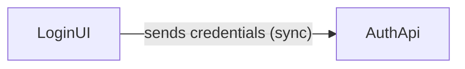

# Component Catalogue

Two building blocks: the React frontend that the user sees, and the Spring Boot backend that decides whether the credentials are valid. Only one decomposition is viable here, because the request fixes the technologies and the validation must stay in the backend (NFR2). Deployment grouping is decided later, in Units Generation.

```yaml
components:
  - name: LoginUI
    summary: React frontend with the login form, the failure message and the "login done" page.
    behaviour: >
      Shows a username field, a password field and a submit control. On submit it sends the
      entered credentials to AuthApi. On a success result it navigates to the "login done" page,
      which displays the text "login done." and nothing else. On a failure result it stays on the
      form and shows the single inline message "Invalid username or password" without saying which
      field was wrong. The "login done" page is not protected and can be opened by its URL. The
      frontend never holds the valid username or password.
    responsibilities:
      - Render the login form and collect the username and password
      - Send the credentials to AuthApi and read the success or failure result
      - Redirect to the "login done" page on success
      - Show the generic inline failure message on failure
      - Render the "login done" page
    depends_on:
      - component: AuthApi
        interaction: Sends the entered credentials and receives a success or failure result
        style: sync
    dependents: []
    external_dependencies: []
    entities: []
  - name: AuthApi
    summary: Spring Boot backend that validates a username and password against the hardcoded demo credential.
    behaviour: >
      Accepts a login request carrying a username and password and reports only success or
      failure. Success means the pair equals demouser / demopassword exactly. Any other pair,
      empty values, and a missing or malformed request body all report failure, never a server
      error. It issues no session or token and checks none.
    responsibilities:
      - Hold the hardcoded demo credential
      - Validate a login request against it
      - Report success or failure to the caller
      - Treat missing or malformed input as a failure
    depends_on: []
    dependents:
      - component: LoginUI
        interaction: Receives login requests from the frontend
    external_dependencies: []
    entities:
      - name: DemoCredential
        identifier: username
        attributes: [username, password]
```

## Component Diagram



Text fallback: LoginUI calls AuthApi synchronously; AuthApi calls nothing.

## Component Summary

| Component | Purpose | Depends On | Dependents | Entities Owned |
|---|---|---|---|---|
| LoginUI | Login form, failure message and "login done" page | AuthApi | none | none |
| AuthApi | Validates the credentials and reports success or failure | none | LoginUI | DemoCredential |

## Entity Ownership

| Entity | Owning Component | Identifier | Attributes | References |
|---|---|---|---|---|
| DemoCredential | AuthApi | username | username, password | none |

## External Dependencies

| Component | Dependency | Kind | Purpose |
|---|---|---|---|
| none | none | none | No database, cache or third-party service is used; the credential is hardcoded. |

## Rationale

| Component | Why it is a separate building block |
|---|---|
| LoginUI | Distinct concern (presentation and navigation) and distinct technology (React). It changes whenever the screens change. |
| AuthApi | Distinct concern (credential validation) and distinct technology (Spring Boot). It owns the only entity and must not leak the credential to the frontend (NFR2). |

**Alternatives Rejected:** a single combined application (for example the React build served by Spring Boot with validation done in the browser) was rejected because the request names a React frontend and a Spring Boot backend, and browser-side validation would expose the credential. See ADR-001 in `decisions.md`.

## Sources

- requirements.md: `aidlc/spaces/default/intents/261115-basic-login/inception/requirements-analysis/requirements.md` (FR1–FR4, NFR1–NFR4)
- stories.md: `aidlc/spaces/default/intents/261115-basic-login/inception/user-stories/stories.md` (US1.1, US1.2, US2.1, US2.2)
- [desc] Initial description: "Build a basic login functionality for a web application using React and Spring Boot."

## Assumptions & Open Questions

None.
