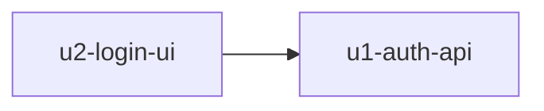

# Unit Dependencies

## Dependency DAG

- u2-login-ui depends on u1-auth-api.
- u1-auth-api depends on nothing.



Text fallback: u2-login-ui depends on u1-auth-api; u1-auth-api has no dependencies. The graph has no cycle.

## Edge Block

```yaml
units:
  - name: u1-auth-api
    kind: service
    depends_on: []
  - name: u2-login-ui
    kind: ui
    depends_on: [u1-auth-api]
```

## Integration Points

| From | To | Mechanism | Notes |
|---|---|---|---|
| u2-login-ui | u1-auth-api | One synchronous HTTP request carrying the username and password; the result is success or failure | The exact endpoint, status codes and body are set in Contract Design (ADR-003). Cross-origin handling for the local run belongs on the u1 side. |

## Parallel Development Opportunities

None are declared. u2-login-ui depends on u1-auth-api, so the two are not built at the same time. This is topology only: the order and any later parallelism are decided in Delivery Planning.

## Sources

- components.md: `aidlc/spaces/default/intents/261115-basic-login/inception/domain-design/components.md` (LoginUI depends on AuthApi)
- decisions.md: `aidlc/spaces/default/intents/261115-basic-login/inception/domain-design/decisions.md` (ADR-003)

## Assumptions & Open Questions

None.
