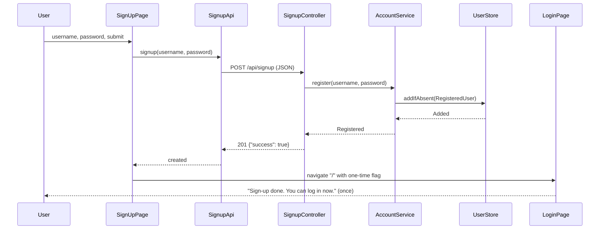
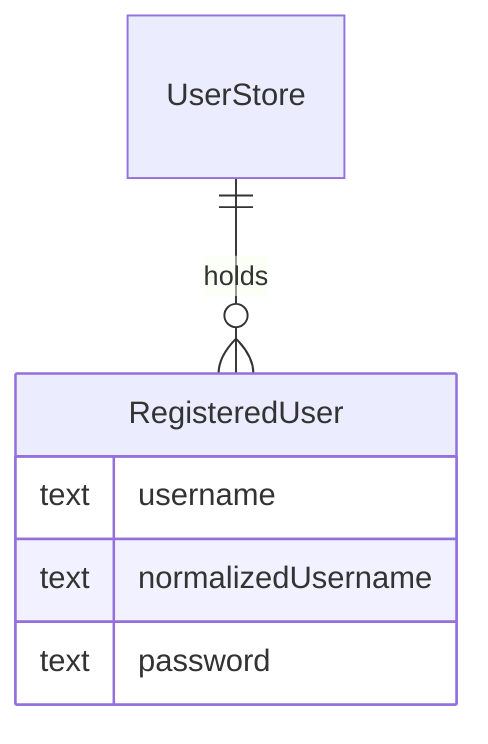

# Functional Specification: u1-create-account

Implements story US2.1 (Jira AP-4). Sources: `unit-of-work.md`, `stories.md`, `requirements.md`, `components.md`, `contract-summary.md` (C1, C3, C4, C5), `mockups.md`, `interaction-spec.md`. Entities in `entities.md`, rules in `rules.md`.

## Workflow: create an account

1. The user opens `/signup` and sees the heading "Sign up", a username field with its hint, a password field with its hint, a "Sign up" button, and an empty message line (BR1.9).
2. The user types a username and a password and activates the button or presses Enter.
3. If a request is already in flight, the submit is ignored; otherwise the button is disabled and `SignupApi` sends `POST /api/signup` with the two values as JSON (BR1.4).
4. `SignupController` answers `400` with `{"success": false}` and no `errors` if a field is missing or null (the check is the controller's own); an unreadable body or wrong content type is answered by the shared handler in the same shape.
5. `SignupController` asks `AccountService.register`. In this unit `register` accepts any non-null username and password (the rules arrive in U2, the taken-name check in U3).
6. `AccountService` builds a `RegisteredUser` (normalizedUsername is the lower-case form of the username) and asks `UserStore.addIfAbsent`. In this unit the result `Added` produces `Registered`; `AlreadyExists` is not exercised by any acceptance criterion here.
7. `SignupController` answers `201` with `{"success": true}` for `Registered`. No cookie, token or session is issued (BR1.6).
8. On `201`, `SignUpPage` navigates to `/` with a one-time flag; `LoginPage` shows "Sign-up done. You can log in now." once, then removes the flag by replacing the history entry. The user is not logged in and is not on `/done` (BR1.5).
9. On any other answer the page enables the button again. The full set of messages is added in U2, U3 and U4; until then a non-`201` answer leaves the message line empty and the user on `/signup`.

Text fallback: the user submits the form; the page calls the sign-up endpoint; the controller asks the service to register; the service adds the user to the store; the controller answers 201; the page goes to the login page, which shows the "Sign-up done" message once.

## State: `SignUpPage` status

| State | Meaning | Moves to |
|---|---|---|
| idle | empty or editing | submitting on submit |
| submitting | request in flight, button disabled | created on 201; idle on any other answer in this unit |
| created | answer 201 received | leaves the page for `/` |

## State: one-time flag on `LoginPage`

| State | Meaning | Moves to |
|---|---|---|
| absent | normal visit or reload | present only on arrival from a 201 |
| present | arrived from a successful sign-up | absent after the message is shown and the history entry replaced |

## Entity relationship (derived from `entities.md`)

Text fallback: the store holds zero or more registered users; each has a typed username, a lower-case key and a password.

## Rules summary (derived from `rules.md`)

BR1.1 valid sign-up answers 201; BR1.2 memory only; BR1.3 lower-case key; BR1.4 one request per submit; BR1.5 redirect with one-time message; BR1.6 no cookie, token or storage; BR1.7 password hidden; BR1.8 CORS for `/api/signup`; BR1.9 labels, hints, keyboard.

## Acceptance criteria covered

| Criterion | Where |
|---|---|
| AC2.1.1 valid sign-up gives 201 and the login page with the message | steps 5 to 8, BR1.1, BR1.5 |
| AC2.1.2 not logged in, not on "login done" | step 8, BR1.5 |
| AC2.1.3 button disabled while in flight | step 3, BR1.4 |
| AC2.1.4 keyboard reachable, visible labels | step 1, BR1.9 |
| AC2.1.5 account gone after restart | BR1.2 |
