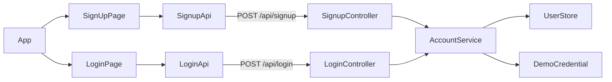

# Component Catalogue: User Sign-Up

Sources: `requirements.md` (FR1-FR7, NFR1-NFR7), `stories.md` (US1.1-US3.3), `architecture.md` and `component-inventory.md` (the existing login components), `team-practices.md` (no design system, test-after), and the answers in `domain-design-questions.md`. Components marked *existing* are already in the code; the others are new. Deployment topology is not decided here; it stays two processes as today (`architecture.md`).

```yaml
components:
  - name: App
    summary: Frontend route table (existing, changed to add the /signup route).
    behaviour: >
      Declares the routes "/" (LoginPage), "/signup" (SignUpPage) and "/done" (the existing
      login-done page, which is not changed and not listed as a component here).
    responsibilities:
      - Map each route to its page
    depends_on:
      - component: SignUpPage
        interaction: renders it at /signup
        style: sync
      - component: LoginPage
        interaction: renders it at /
        style: sync
    dependents: []
    entities: []

  - name: SignUpPage
    summary: Registration form page (new).
    behaviour: >
      Shows username and password fields with rule hints, one submit button and one message line.
      Disables the button while a request is in flight. On 201 it navigates to the login page and
      hands over a one-time "sign-up done" flag. On 400 and 409 it shows the matching message,
      keeps the username and clears the password. On any other status or a network error it shows
      the unreachable message and keeps both fields. Writes nothing to browser storage.
    responsibilities:
      - Collect username and password and submit them once
      - Show validation, taken-name and unreachable messages
      - Link back to the login page
    depends_on:
      - component: SignupApi
        interaction: sends the sign-up request and reads the status
        style: sync
    dependents:
      - component: App
        interaction: routed at /signup
    entities: []

  - name: LoginPage
    summary: Login form page (existing, changed).
    behaviour: >
      Unchanged login behavior. Adds a "Sign up" link and shows the one-time "sign-up done"
      message in its message line, once, when it arrives from a successful sign-up.
    responsibilities:
      - Collect credentials and submit them
      - Show failure, unreachable and one-time sign-up-done messages
      - Link to the sign-up page
    depends_on:
      - component: LoginApi
        interaction: sends the login request and reads the status
        style: sync
    dependents:
      - component: App
        interaction: routed at /
    entities: []

  - name: SignupApi
    summary: Frontend HTTP client for sign-up (new).
    behaviour: >
      Posts the username and password as JSON to POST /api/signup under the same base URL setting
      as the login client. Maps the answer to success (201), invalid (400), taken (409) or
      unreachable (anything else or a thrown error). Never logs the password.
    responsibilities:
      - Call the sign-up endpoint and translate its status
    depends_on:
      - component: SignupController
        interaction: POST /api/signup
        style: sync
    dependents:
      - component: SignUpPage
        interaction: called on submit
    entities: []

  - name: LoginApi
    summary: Frontend HTTP client for login (existing, unchanged).
    behaviour: >
      Posts credentials to POST /api/login and maps the answer to success, failed or unreachable.
    responsibilities:
      - Call the login endpoint and translate its status
    depends_on:
      - component: LoginController
        interaction: POST /api/login
        style: sync
    dependents:
      - component: LoginPage
        interaction: called on submit
    entities: []

  - name: SignupController
    summary: REST endpoint for registration (new).
    behaviour: >
      Handles POST /api/signup. Answers 400 when a field is missing, null, not text or the body
      is unreadable, or when AccountService reports a rule failure; 409 when AccountService
      reports the username is taken; 201 with {"success": true} on success. Issues no cookie or
      token. Its request type hides the password in its text form.
    responsibilities:
      - Translate HTTP requests into AccountService calls and results into status codes
      - Keep the password out of logs and responses
    depends_on:
      - component: AccountService
        interaction: register the user
        style: sync
    dependents:
      - component: SignupApi
        interaction: receives the sign-up request
    entities: []

  - name: LoginController
    summary: REST endpoint for login (existing, changed to ask AccountService).
    behaviour: >
      Handles POST /api/login. Status behavior is unchanged: 400 for missing or null fields,
      401 with the same body for every failure, 200 on success, no cookie or token. The decision
      whether the credentials are valid now comes from AccountService instead of DemoCredential.
    responsibilities:
      - Translate HTTP requests into an AccountService check and results into status codes
    depends_on:
      - component: AccountService
        interaction: authenticate the credentials
        style: sync
    dependents:
      - component: LoginApi
        interaction: receives the login request
    entities: []

  - name: AccountService
    summary: Business rules for registration and authentication (new).
    behaviour: >
      Registration: accepts a username only if it is 3-20 characters of A-Z, a-z, 0-9,
      underscore or hyphen, and a password only if it is at least 8 characters (spaces count, kept
      as typed); rejects a username that equals the demo user's or a registered user's name
      compared without regard to case; stores the username as typed and compares it in lower
      case. Authentication: true when the credentials match the demo user exactly (existing rule)
      or match a registered user by username without regard to case and password exactly.
      Returns the same single failure result for every failed authentication, so callers cannot
      tell which part was wrong. Never logs a password.
    responsibilities:
      - Validate sign-up input and report which rule failed
      - Enforce unique usernames, including the demo user's name
      - Authenticate against the demo user and the registered users
    depends_on:
      - component: UserStore
        interaction: add a user atomically, look a user up
        style: sync
      - component: DemoCredential
        interaction: check the demo user's exact credential and name
        style: sync
    dependents:
      - component: SignupController
        interaction: registration
      - component: LoginController
        interaction: authentication
    entities: []

  - name: UserStore
    summary: In-memory holder of registered users (new).
    behaviour: >
      Keeps registered users only in the memory of the running backend; nothing is written to
      disk or sent to any other process, and everything is lost on restart. Adding a user whose
      normalized username already exists fails without changing anything. Safe for concurrent
      requests: two simultaneous adds of the same username produce exactly one success.
    responsibilities:
      - Hold registered users in memory
      - Add a user atomically and look a user up by normalized username
    depends_on: []
    dependents:
      - component: AccountService
        interaction: reads and writes users
    entities:
      - name: RegisteredUser
        identifier: normalizedUsername
        attributes: [username, normalizedUsername, password]

  - name: DemoCredential
    summary: The single built-in demo user (existing, unchanged).
    behaviour: >
      Holds the constant demo username and password and compares them exactly, including letter
      case, rejecting null and empty values. Its tests keep their meaning.
    responsibilities:
      - Answer whether a username and password equal the demo credential
    depends_on: []
    dependents:
      - component: AccountService
        interaction: authentication and the reserved demo name
    entities: []
```

## Component Diagram



Text fallback: App routes to SignUpPage and LoginPage; each page calls its API client; SignupApi calls SignupController and LoginApi calls LoginController; both controllers call AccountService; AccountService uses UserStore and DemoCredential.

## Component Summary

| Component | Purpose | Depends On | Dependents | Entities Owned |
|---|---|---|---|---|
| App | Route table (existing, changed) | SignUpPage, LoginPage | none | none |
| SignUpPage | Registration form (new) | SignupApi | App | none |
| LoginPage | Login form (existing, changed) | LoginApi | App | none |
| SignupApi | Sign-up HTTP client (new) | SignupController | SignUpPage | none |
| LoginApi | Login HTTP client (existing) | LoginController | LoginPage | none |
| SignupController | POST /api/signup (new) | AccountService | SignupApi | none |
| LoginController | POST /api/login (existing, changed) | AccountService | LoginApi | none |
| AccountService | Registration and authentication rules (new) | UserStore, DemoCredential | SignupController, LoginController | none |
| UserStore | In-memory users (new) | none | AccountService | RegisteredUser |
| DemoCredential | Demo user constant (existing) | none | AccountService | none |

## Entity Ownership

| Entity | Owning Component | Identifier | Attributes | References |
|---|---|---|---|---|
| RegisteredUser | UserStore | normalizedUsername | username, normalizedUsername, password | none |

Types, lengths and exact validation values belong to Functional Design; here only ownership and shape are fixed.

## External Dependencies

| Component | Dependency | Kind | Purpose |
|---|---|---|---|
| none | none | none | No database, cache or other external service is used (FR5.3). |

## Rationale

| Component | Why it is a separate building block |
|---|---|
| SignUpPage | Distinct screen and message states from the login page; the existing "login done" page must stay untouched |
| SignupApi | Distinct endpoint and status mapping (adds 409) from the login client, which is unchanged |
| SignupController | Distinct URL and result codes (201, 409) from login; keeps HTTP concerns away from the rules |
| AccountService | One home for the rules shared by sign-up and login (name comparison, demo name reserved); decided in ADR-001 |
| UserStore | Owns the only new data and its concurrency guarantee; a later real database replaces only this block |
| DemoCredential | Already exists with its own tests; kept as is (ADR-002) |

Alternatives Rejected: controllers calling the store directly (rules spread over two controllers, ADR-001); seeding the demo user into the store (changes the demo user's comparison and its tests, ADR-002). No dependency cycle exists in this design.
