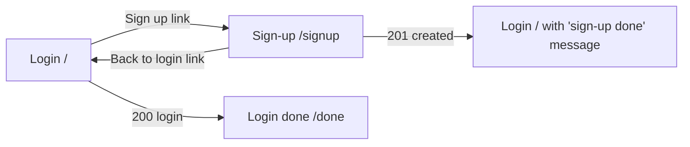

# Mockups: Sign-Up

Sources: `stories.md` (US1.1, US2.1-US2.4, US3.1, US3.3), `requirements.md` (FR1, FR2, FR3, FR4, NFR6), `team-practices.md` (Code Style: frontend is ESLint and Prettier, no design system), and the choices in `refined-mockups-questions.md`. The Ideation wireframes and user flow do not exist in the classic plan, so these mockups are drawn directly from the stories and requirements.

Design choices (from the questions): same plain look as the login page, rule hints under each field, and the "sign-up done" message shown once in the login page's message line.

## Screen map

| Screen | Route | Stories |
|---|---|---|
| Login (changed) | `/` | US1.1, US2.1 (shows "sign-up done"), US3.1 |
| Sign-up (new) | `/signup` | US1.1, US2.1, US2.2, US2.3, US2.4 |
| Login done (unchanged) | `/done` | US3.3 |



Text fallback: Login links to Sign-up and back; a successful sign-up goes to Login with a "sign-up done" message; a successful login goes to the Login done page.

## Screen 1: Login (changed)

Existing heading, fields and button are unchanged. Two additions: a message line that can show "Sign-up done", and a "Sign up" link below the form.

```
+--------------------------------------------+
| Login                                      |   <h1>
|                                            |
| Username                                   |
| [______________________________]           |
| Password                                   |
| [______________________________]           |
| [ Log in ]                                 |
|                                            |
| (message line, alert/status region)        |   empty, or one of:
|   "Sign-up done. You can log in now."      |     after a successful sign-up
|   "Invalid username or password"           |     after a failed login
|   "Unable to reach the server. ..."        |     when the server is unreachable
|                                            |
| Need an account? Sign up                   |   link to /signup
+--------------------------------------------+
```

States: default (empty message), submitting (button disabled), failed, unreachable, sign-up done (shown once, see the interaction spec). Covers AC1.1.1, AC2.1.1, AC2.1.2, AC3.1.2.

## Screen 2: Sign-up (new)

```
+--------------------------------------------+
| Sign up                                    |   <h1>
|                                            |
| Username                                   |
| [______________________________]           |
| 3-20 letters, digits, underscores or       |   always-visible hint
| hyphens                                    |
|                                            |
| Password                                   |
| [______________________________]  (masked) |
| At least 8 characters                      |   always-visible hint
|                                            |
| [ Sign up ]                                |
|                                            |
| (message line, alert region)               |   empty, or one of the errors below
|                                            |
| Already have an account? Back to login     |   link to /
+--------------------------------------------+
```

### Message line states

| State | Message text | Username field | Password field | Button | Covers |
|---|---|---|---|---|---|
| default | (empty) | empty | empty | enabled | AC2.1.1 |
| submitting | (empty) | kept | kept | disabled | AC2.1.3 |
| invalid username | "Username must be 3-20 letters, digits, underscores or hyphens." | kept | cleared | enabled | AC2.2.1, AC2.2.2, AC2.2.4 |
| invalid password | "Password must be at least 8 characters." | kept | cleared | enabled | AC2.2.3, AC2.2.4 |
| username taken | "Username already taken" | kept | cleared | enabled | AC2.3.1, AC2.3.2, AC2.3.4 |
| unreachable or unexpected status | "Unable to reach the server. Please try again." | kept | kept | enabled | AC2.4.1, AC2.4.2 |
| success | (page changes) | n/a | n/a | n/a | AC2.1.1 |

When both fields break a rule, the message line shows one combined message naming both (decided here as a design default, open to change at the gate): "Username must be 3-20 letters, digits, underscores or hyphens. Password must be at least 8 characters."

## Screen 3: Login done (unchanged)

```
+--------------------------------------------+
| login done.                                |   no links, no buttons
+--------------------------------------------+
```

Covers AC1.1.3 and AC3.3.4: nothing is added to this page.

## Responsive behavior

One fluid single-column layout, the same as the login page today: content stacks vertically and the form fields take the available width at any size. No separate mobile, tablet or desktop layout is specified.
