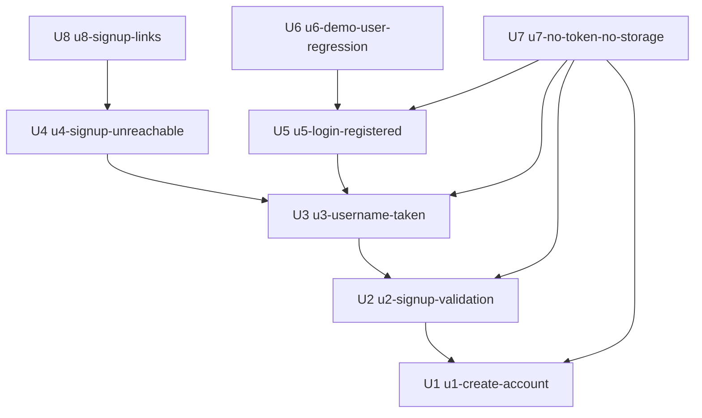

# Unit Dependencies: User Sign-Up

Sources: `unit-of-work.md`, `components.md` (component dependencies), `stories.md` (story dependencies). This file describes topology only. It does not choose a build order or a critical path; Delivery Planning does that.

Edge rule used throughout: a unit depends on every unit whose code it builds on, shares files with, or exercises directly in its own tests. A unit reached only through another listed unit is not repeated. Units that edit the same files are chained so that none of them needs to be built in a separate copy.

## Dependency Graph

Direct dependencies ("A depends on B"):

- U1 u1-create-account depends on nothing.
- U2 u2-signup-validation depends on U1.
- U3 u3-username-taken depends on U2 (shares `AccountService.register`, `SignupController`, `SignUpPage` and `SignupApi` with U2).
- U4 u4-signup-unreachable depends on U3 (shares the `SignUpPage` and `SignupApi` status mapping with U2 and U3).
- U5 u5-login-registered depends on U3 (shares `AccountService` and `UserStore` with U1 to U3 and reuses U1's lower-case username key).
- U6 u6-demo-user-regression depends on U5 (tests the demo user through the login path U5 builds).
- U7 u7-no-token-no-storage depends on U1, U2, U3 and U5 (its checks run against the sign-up success, the 400 and 409 error paths, and the login path).
- U8 u8-signup-links depends on U4 (shares `SignUpPage` with U1 to U4; it also needs the sign-up page from U1).



Text fallback: U2 depends on U1; U3 on U2; U4 and U5 on U3; U6 on U5; U7 on U1, U2, U3 and U5; U8 on U4. The graph has no cycle.

```yaml
units:
  - name: u1-create-account
    kind: service
    depends_on: []
  - name: u2-signup-validation
    kind: service
    depends_on: [u1-create-account]
  - name: u3-username-taken
    kind: service
    depends_on: [u2-signup-validation]
  - name: u4-signup-unreachable
    kind: ui
    depends_on: [u3-username-taken]
  - name: u5-login-registered
    kind: service
    depends_on: [u3-username-taken]
  - name: u6-demo-user-regression
    kind: service
    depends_on: [u5-login-registered]
  - name: u7-no-token-no-storage
    kind: service
    depends_on: [u1-create-account, u2-signup-validation, u3-username-taken, u5-login-registered]
  - name: u8-signup-links
    kind: ui
    depends_on: [u4-signup-unreachable]
```

## Integration Points

| Between | Integration | Contract owner |
|---|---|---|
| U1, U2, U3 | `AccountService.register`, `SignupController`, `SignUpPage` and `SignupApi` are extended in turn | Contract Design |
| U1 and U3, U5 | `UserStore` keeps users under a lower-case username key that U1 creates; U3 adds the atomic add and demo-name reservation; U5 reads by the same key | Contract Design |
| U3, U4 | `SignupApi` status mapping (201, 400, 409, unreachable) grows in each | Contract Design |
| U4 and U8 | `SignUpPage` carries the "Back to login" link added last | Refined Mockups |
| U5 and U6, U7 | the login path under test | Contract Design |
| Frontend and backend (all) | `POST /api/signup` and `POST /api/login` over HTTP, same configured origin | Contract Design |

Field hints under the sign-up fields (static text) are owned by U1; the rule checks and their error messages are owned by U2.

## Parallel Development Opportunities

Units with no path between them: U4 and U5 (both follow U3, and they edit different files), and the chain U6 after U5 with U4 then U8. Beyond that the graph is close to a single line, because most units edit the same files. This team works one ticket at a time (project rule), so no parallel build is planned.
